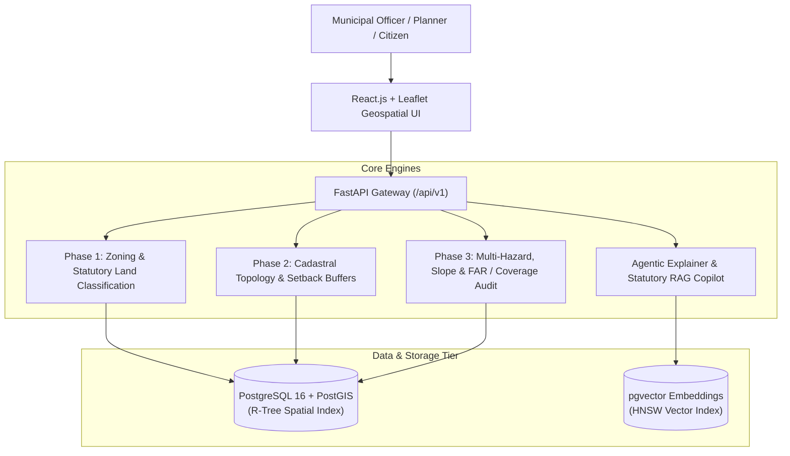

# GeoRAG+: Agentic Geospatial RAG & Smart Governance Platform

[](https://www.python.org/)
[](https://fastapi.tiangolo.com)
[](https://www.postgresql.org/)
[](https://postgis.net/)
[](https://github.com/pgvector/pgvector)
[](https://react.dev/)
[](https://leafletjs.com/)
[](backend/tests/)

> **An Agentic Multi-Modal Geospatial RAG System for Autonomous Terrain Analysis, Hydrodynamic Simulation, and Smart Governance**  
> *Target Study Area:* Attingal Municipality (Thiruvananthapuram District, Kerala, India)

---

## 📌 Overview & Core Invariants

Traditional GIS tools (e.g. ArcGIS, QGIS) require specialized training, have prohibitive licensing costs, and operate completely isolated from statutory regulatory databases. Meanwhile, standard LLM chatbots suffer from **catastrophic spatial hallucinations**—inventing cadastral parcel boundaries, hallucinating setbacks, and failing at metric planar coordinates.

**GeoRAG+** solves this by enforcing a strict architectural invariant:

> 🛡️ **Invariant: Strict Decoupling of Cognition and Computation**  
> *The computer computes; the LLM only orchestrates, explains, and cites.*  
> Spatial math, setback buffers, slope analysis, and zoning queries are calculated strictly by **PostGIS (R-Tree indexed)**, **pgvector (HNSW indexed)**, and **NumPy / Shapely**. The LLM operates solely as an orchestrator and explainer, backed by statutory citations (KMBR 2019, KPBR 2019, Kerala Wetland Act 2008).

---

## 🏛️ System Architecture



---

## ✨ Key Capabilities

1. **Phase 1: Statutory Zoning & Due Diligence**
   - Automated screening against the **Kerala Conservation of Paddy Land and Wetland Act, 2008**.
   - Identifies restricted nilam/paddy zones, buffer prohibitions, and coastal CRZ/floodplain risks.

2. **Phase 2: Cadastral Boundaries & Precise Setbacks**
   - Precise PostGIS metric buffering (`ST_Transform` to EPSG:3857/EPSG:32643) for exact frontage, rear, and side yard setbacks under **KMBR 2019** (Rule 23, 25, 27) and **KPBR 2019**.
   - Computes compliant buildable footprints from parcel geometries.

3. **Phase 3: Multi-Hazard Analysis & FAR Compliance**
   - Horn’s slope calculation and Digital Elevation Model (DEM) risk stratification.
   - Floor Area Ratio (FAR), Maximum Coverage %, and parking / access width verification against Table 6 (Rule 50).

4. **Agentic Explainer & Statutory RAG**
   - Dynamic prompt orchestration that cites exact statutory sub-rules and gazetted notifications.
   - Dual-mode LLM fallback: automatic failover across Google Gemini, OpenAI, local Ollama, or deterministic fallback engines.

---

## 🛠️ Tech Stack

- **Backend:** Python 3.11+, FastAPI, SQLAlchemy, GeoAlchemy2, Pydantic v2
- **Spatial Database:** PostgreSQL 16, PostGIS 3.4 (R-Tree), pgvector 0.7+ (HNSW)
- **Geospatial Processing:** GDAL/OGR, Shapely, OSMnx, PyProj
- **AI & RAG:** Google Gemini API, OpenAI API, LangChain / pgvector cosine similarity search
- **Frontend:** React 18, Vite, Leaflet, React-Leaflet, TailwindCSS
- **Containerization & CI:** Docker Compose, PyTest (69 automated unit & regression tests)

---

## 🚀 Quick Start Guide

### 1. Prerequisites
- [Docker & Docker Compose](https://www.docker.com/)
- [Python 3.11+](https://www.python.org/)
- [Node.js 18+](https://nodejs.org/)

### 2. Database Setup (Docker)
```bash
# Clone the repository
git clone https://github.com/NaveenSuresh07/georag-plus.git
cd georag-plus

# Start PostGIS and pgvector database
docker-compose up -d

# Verify database health
docker exec -it georag-db pg_isready -U georag
```

### 3. Backend Setup
```bash
cd backend
python -m venv .venv

# On Windows:
.venv\Scripts\activate
# On Linux/macOS:
# source .venv/bin/activate

pip install -r requirements.txt

# Run migrations & seed baseline data
python scripts/load_rule_params.py

# Run test suite (69 tests)
pytest tests/ -v

# Start FastAPI dev server
uvicorn app.main:app --reload --port 8000
```
Backend API will be available at `http://localhost:8000/docs`.

### 4. Frontend Setup
```bash
cd ../frontend
npm install
npm run dev
```
Interactive GIS Dashboard will be available at `http://localhost:5173`.

---

## 🧪 Testing & Verification

The system includes a comprehensive automated test suite verifying spatial mathematics, edge-case parcels, and statutory edge rules:

```bash
cd backend
pytest tests/ -v
```
- ✅ **Test Coverage:** 69 passing test cases
- ✅ **Statutory Benchmarks:** 20 ground-truth cadastral plots in Attingal Municipality verified against official master plan records.

---

## 📄 License & Academic Attribution
Developed as part of the **GeoRAG+ Research Initiative (Group - 6)**.  
Open-source under the [MIT License](LICENSE).
